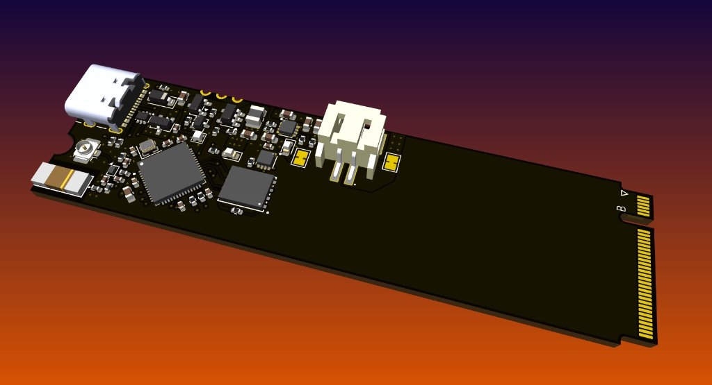

# NX-Edge

> **High-Density Modular Embedded Development Platform**  
> *M.2 2280 Key B • 6-Layer High-Density RF/Power Stackup • ESP32-S3 Dual-Core 240MHz • Autonomous LiPo Power-Path & Fuel Gauge • Dual-Antenna RF Front-End • Switched NeoPixel Driver*

---

<p align="center">
  
</p>
<p align="center">
  <em>NX-Edge 3D Render — Dense 6-layer layout in M.2 2280 Key B form factor featuring 45° ESP32-S3, WSON-8 Flash, Ignion Chip Antenna + U.FL, LiPo Charger, Fuel Gauge, 2A Buck Regulator, and Switched NeoPixel Bus.</em>
</p>

---

## Overview

The **NX-Edge** is an ultra-dense, agile embedded development platform engineered to bridge the gap between high-speed benchtop prototyping and space-constrained, high-vibration interactive builds (tactical gear, robotics, custom sabers, wearable tech, and modular IoT nodes).

Built in the standard **M.2 2280 ($22 \times 80\text{ mm}$)** envelope on an advanced **6-layer high-density PCB** with **100% single-sided component placement** (zero components on the bottom layer), the NX-Edge delivers a **hybrid mechanical and electrical architecture**:

1. **The Modular Cartridge:** Standard **M.2 Key B edge connector** (up to 75 pins) allowing the board to slide directly into low-profile carrier boards, custom backplanes, or modular hilt sleds.
2. **The Castellated Prototyping Companion:** Dual perimeter rows of **castellated edge holes and solder pads** allow the board to be used directly on breadboards with pin headers, wired via fly-leads, or soldered flat as a surface-mount System-on-Module (SoM) onto carrier PCBs without requiring an M.2 socket.
3. **Zero-Z Flat Bottom:** Because all active ICs, passives, and connectors are strictly top-mounted, the bottom is flat copper and solder mask—allowing it to be mounted flush against aluminum chassis, heatsinks, 3D prints, or battery packs using thermal tape without risk of short circuits.

> [!IMPORTANT]
> **NX Custom Maker Interconnect (Non-PC Hardware):**  
> While the board utilizes the standard mechanical **M.2 Key B form factor and connector**, the pinout is a **custom, high-power maker standard** (similar to SparkFun MicroMod). The M.2 connector routes raw battery power, high-current 5V rails, speaker outputs, and 3.3V GPIOs directly to custom carrier boards. **Do NOT plug this board into a standard PC motherboard M.2 NVMe/SATA slot.**

---

## Current Hardware Implementation Status

| Subsystem / Block | Status | Key Components & Implementation Details |
| :--- | :---: | :--- |
| **Compute Core** | **Routed** | ESP32-S3 (bare QFN-56 @ 45°), 40 MHz 2016 crystal with symmetrical wings, decoupling network on power rails. |
| **Flash Memory** | **Routed** | 16 MB Winbond `W25Q128JVPIQ` (WSON-8), inline decoupling, Quad-SPI bus routed on internal Layer 3 stripline. |
| **RF Front-End** | **Routed** | Ignion `NN02-201` ceramic antenna + Hirose U.FL receptacle + Infineon `BGS12WN6` SPDT RF switch (`RF_CTRL`). |
| **USB Type-C** | **Routed** | Reversible Type-C receptacle, `USBLC6-2SC6` ESD array, dual $5.1\,\text{k}\Omega$ CC pulldowns (`R20`/`R21`), D+/D- internal stripline. |
| **LiPo Charging** | **Routed** | TI `BQ25170` autonomous linear charger (600–800 mA), status LED, horizontal JST-PH 2.0mm connector (`P1`/`P2`). |
| **True 0µA Standby** | **Routed** | Solder jumper & switch pad `JP2` between battery and system rail for an external physical power switch. |
| **Buck Regulator** | **Routed** | TI `TLV62569` synchronous buck converter delivering continuous **3.3V @ 2.0A** with low ripple. |
| **Fuel Gauge** | **Routed** | Maxim `MAX17048` ModelGauge™ I2C fuel gauge (`0x36`) for cell voltage ($V_{CELL}$) and SoC% without IR drop. |
| **NeoPixel Driver** | **Routed** | P-FET `Q2` (DMP3130L-7) + NPN `Q3` (BC847W) on `IO12` with 3 castellated pads (`VN`, `NPD_IN`, `GND`) for high-power strips. |
| **Onboard Indicators**| **Routed** | Onboard RGB NeoPixel (WS2812B/SK6812) powered from `VN` + User LED (LED13 / `D3`) with resistor `R13`. |
| **6-Layer Stackup** | **Configured**| Upgraded from 4-layer to high-density 6-layer with 0.45 mm / 0.25 mm micro-vias for optimal signal integrity. |
| **MicroSD Slot** | *Planned* | Molex 105162 push-pull slot running in native **4-bit hardware SDMMC** mode via ESP32-S3 DMA engine. |
| **Motion Sensor** | *Planned* | CEVA / Hillcrest Labs `BNO085` 9-DOF IMU with dedicated 32.768 kHz quartz crystal and sensor-fusion engine. |
| **Audio Amplifier** | *Planned* | Maxim `MAX98357A` I2S Class-D mono amplifier delivering up to 3.2W into 4Ω directly from `VIN`. |
| **RTC Subsystem** | *Planned* | Micro Crystal `RV-3028-C7` extreme low-power ($45\,\text{nA}$) real-time clock with backup cap `C34`. |

---

## 6-Layer High-Density Stackup Architecture

To ensure pristine signal integrity, zero electromagnetic interference (EMI) between the 2.4 GHz RF stage and high-speed digital buses, and effortless escape routing for QFN/WSON packages, the NX-Edge employs an industrial **6-layer symmetrical stackup**:

| Layer | KiCad Layer | Type | Copper Role & Signal Integrity Function |
| :---: | :---: | :---: | :--- |
| **L1** | `F.Cu` | Mixed / Top | Component mounting, 2.4 GHz RF transmission line, localized power pours (`VIN`, `+3V3`, `VBAT`). |
| **L2** | `In1.Cu` | Plane | **Solid Ground Plane (GND):** Uninterrupted return path and Faraday shield directly below Top layer. |
| **L3** | `In2.Cu` | Stripline Sig | **High-Speed Signal Highway:** Fully shielded internal striplines for **USB D+/D-**, **Flash Quad-SPI**, and **SDMMC**. |
| **L4** | `In3.Cu` | Power Plane | **Power Plane Mosaic:** Low-impedance internal distribution for `+3V3`, `VBUS`, and `VBAT`. |
| **L5** | `In4.Cu` | Plane | **Secondary Solid Ground Plane (GND):** Complete ground shield referencing Bottom layer. |
| **L6** | `B.Cu` | Mixed / Bottom | Non-critical escape routing, switched `VN` power plane, M.2 docking fingers, and edge test pads. |

* **Via Geometry:** Optimized to **0.45 mm pad diameter / 0.25 mm drill hole** (0.1 mm annular ring), shrinking via area by ~45% compared to standard 0.6/0.3 mm vias and allowing traces to slip between pins without DRC bottlenecks.

---

## Power Architecture & Power-Path Topology

The NX-Edge implements an autonomous, low-loss **Power-Path management architecture**:

```text
  USB-C (VBUS 5V) ──► [Schottky D2] ─────────┐
                                              │
  LiPo (VBAT) ────► [Hard-Cut JP2] ──► [Q1] ──┴─► [ VIN ] (Automatic System Rail)
                                        ▲           │
                                        │ Gate      ├─► [TLV62569 Buck] ──► +3V3 (2.0A)
                                  (VBUS Controlled) │
                                                    ├─► [MAX17048 Gauge] (I2C SoC Monitoring)
                                                    │
                                                    └─► [Q2 P-FET / Q3 NPN] ──► VN (Switched NeoPixel Rail)
                                                              ▲
                                                              │ GPIO12 (CTRL_NP)
```

1. **Automatic Power-Path Node (`VIN`):**
   * Sourced through Schottky diode from USB `VBUS` ($5.0\text{V}$) or low-loss P-MOSFET from battery `VBAT` ($3.7\text{–}4.2\text{V}$).
   * **USB Connected:** `VBUS` holds the P-FET gate high, completely isolating the battery from system discharge. `VIN` runs directly on USB power ($\approx 4.8\text{–}5.0\text{V}$).
   * **Battery Only:** When USB is disconnected, a gate pull-down immediately engages the P-FET ($R_{DS(on)} \approx 30\text{ m}\Omega$), supplying `VIN` with virtually zero voltage drop.
2. **System Buck Regulator (`TLV62569`):**
   * Synchronous step-down buck converter delivering **$3.3\text{V} @ \mathbf{2.0\text{A}}$ continuous** with $>95\%$ efficiency.
   * Powers the ESP32-S3, Flash, sensors, and peripherals cleanly without thermal throttling.
3. **Autonomous LiPo Charger (`BQ25170`):**
   * Standalone linear charger powered from `VBUS` configured for $600\text{–}800\text{ mA}$ charging with NTC thermistor input.
   * **Decoupled Charging:** Because the system and external LEDs run from `VIN`, charging current is never hijacked by system load.
4. **ModelGauge™ Fuel Gauge (`MAX17048`):**
   * Precision I2C fuel gauge (`0x36`) monitoring cell voltage directly at the battery connector. Reports cell voltage ($V_{CELL}$ in mV), State of Charge (SOC %), and rate of change over I2C without burning ADC channels or suffering from trace IR-drop.
5. **Smart NeoPixel Power-Cut (`VN`):**
   * High-side P-MOSFET `Q2` driven by NPN BJT `Q3` controlled via **GPIO12 (`CTRL_NP`)**.
   * In Standby/Deep Sleep (`CTRL_NP = LOW`), power to both onboard and external NeoPixels is cut to $0.0\text{V}$, eliminating the $\sim 1\text{ mA}$ per-pixel quiescent vampire draw ($0.0\,\mu\text{A}$ standby).

---

## RF Agility & Dual-Antenna Switching

* **RF Switch:** Infineon **`BGS12WN6`** ultra-miniature ($0.7 \times 1.1\text{ mm}$) SPDT RF switch rated up to $6\text{ GHz}$ with $<0.3\text{ dB}$ insertion loss.
* **Control:** Controlled via **`RF_CTRL`**:
  * **Low (Default):** On-board high-efficiency **Ignion NN02-201** ceramic chip antenna.
  * **High:** Micro-coaxial **Hirose U.FL / IPEX** receptacle for external antenna routing out of metal, carbon fiber, or shielded enclosures.

---

## Mechanical Specifications

* **Form Factor Standard:** M.2 2280 ($22.0\text{ mm} \times 80.0\text{ mm}$).
* **Connector Type:** M.2 Key B card edge (up to 75 pins).
* **PCB Thickness:** Standard $1.6\text{ mm}$ (or $0.8\text{ mm}$ option for slimline M.2 sockets).
* **Component Clearance:** 100% single-sided top placement. Completely flat bottom surface.
* **Prototyping Headers:** Dual-edge castellated pin holes for breadboards and surface mounting.

---

## License & Ownership

* **Hardware Design:** Licensed under the [CERN Open Hardware Licence Version 2 - Strongly Reciprocal (CERN-OHL-S)](https://ohwr.org/cernohl).
* **Firmware / BSP:** Licensed under the [GNU General Public License v3.0 (GPLv3)](https://www.gnu.org/licenses/gpl-3.0.en.html).
* **Engineering & Ownership:** Conceptualized, engineered, and maintained by [@Ghost3379](https://github.com/Ghost3379).
