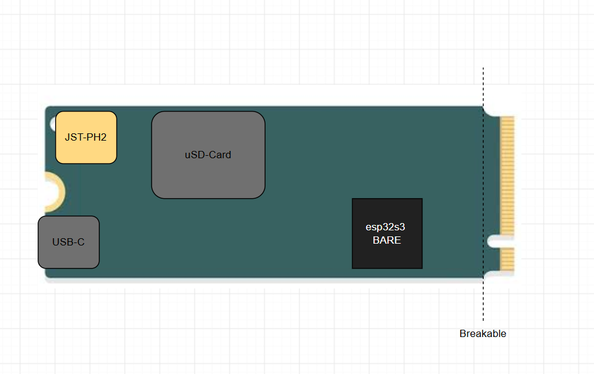

# NX-DS3

> **High-Density Modular Development Platform**  
> *M.2 2260 Form Factor • Breakable Nucleo-Style Blade • ESP32-S3R8 • 2A Power Tree • 9-DOF IMU • I2S Audio*

---

## Overview

The **NX-DS3** is an ultra-dense, versatile embedded development board engineered to bridge the gap between high-speed benchtop breadboard prototyping and space-constrained, high-vibration interactive builds (props, robotics, wearables, and modular IoT nodes).

> [!IMPORTANT]
> **NX Proprietary Docking Port (Non-PC Hardware Interconnect):**  
> While the board utilizes the standard mechanical **M.2 Key-E form factor and connector**, the pinout is an **independent, custom maker standard** (similar to the SparkFun MicroMod architecture). The M.2 connector routes raw battery power, high-current 5V LED rails, speaker outputs, and 3.3V GPIOs directly to custom carrier boards. **Do NOT plug this board into a personal computer's motherboard M.2 slot.**

Built on a compact **0.8mm PCB in the M.2 2260 ($22 \times 60\text{ mm}$) envelope** with **100% single-sided component placement** (zero components on the bottom layer), the NX-DS3 introduces a **dual-personality mechanical architecture**:
1. **The Modular Cartridge**: A standard **M.2 Key-E edge connector** allowing the board to slide directly into low-profile carrier boards, custom backplanes, or modular hilt sleds.
2. **The Breakable Blade**: Inspired by the STMicroelectronics Nucleo ST-Link snap-off design, users who do not need the M.2 interface can **snap off the gold-finger tab along perforated mousebites**, instantly shortening the board from $60\text{ mm}$ to **$52\text{ mm}$ (identical to standard Adafruit Feather length)** and exposing a clean row of high-power solder pads.
3. **The Breadboard Companion**: Dual rows of standard **2.54mm (0.1") castellated pins** running along the perimeter allow the board to sit cleanly on standard breadboards or be surface-mounted directly to carrier PCBs.
4. **Zero-Z Flat Bottom**: Because all ICs, passives, and connectors are strictly top-mounted, the bottom is completely smooth fiberglass and copper—allowing it to be mounted flush against aluminum, 3D prints, or battery packs using thermal tape without risk of short circuits.

<p align="center">
  
</p>
<p align="center">
  <em>NX-DS3 Architectural Concept — M.2 2260 Form Factor with Breakable Key-E Tab & SMT Rear Power Tail.</em>
</p>

```text
                               22.0 mm
          +-------------[ Mid-Mount USB-C ]-------------+
         / [M2]                                    [M2] \
        | (JST-PH)                                       |
        | [=] GPIO                              GPIO [=] |
        | [=]                                        [=] |
        | [=]       2.54mm (0.1") Castellated        [=] |
        | [=]       Standard Breadboard Edges        [=] |
 60.0mm | [=]                                        [=] |
        |                                                |
        |                                                |
        | : : : : : : : : : : : : : : : : : : : : : : : :|  <-- PERFORATED SNAP LINE
        |                                                |      (Snaps to 52mm Feather length)
        +---\                                        /---+
             |===|===|===|===[  KEY E  ]===|===|===|===|
```

---

## Naming & Lineage

```text
N X - D S 3
│     │  │
│     │  └─► ESP32-S3 (Dual-Core 240MHz, Vector DSP, Native USB-OTG)
│     │
│     └─► Development Platform (Direct sibling to the NX-ISD sensor series)
│         [Lore Easter Egg: Deep Space 3 / Starfleet Outpost Designation]
│
└─► Prototyping Series (Continuous Experimental Fleet Registry)
```

* **Lineage:** Direct architectural evolution of the [`NX-ISD`](https://github.com/Ghost3379) (Intelligent Sensor Device). While the `NX-ISD` was purpose-built for tactical environmental and physiological sensing (BME680, MAX30102, display UI), the **`NX-DS3`** strips away enclosure-bound sensors to provide a pure, agile, high-horsepower development core with generous "batteries-included" onboard peripherals.
* **The "NX" Philosophy:** Inspired by Starfleet's experimental registry designation ([Memory Alpha: NX](https://memory-alpha.fandom.com/wiki/NX)), the **NX** prefix denotes an active, pioneering prototyping platform where each build is an evolving hardware milestone.

---

## Core Hardware Specifications

### 1. Compute & High-Speed Memory
* **SoC:** Espressif **ESP32-S3R8** (Bare QFN-56 package, $7 \times 7\text{ mm}$).
  * Dual-Core Xtensa® 32-bit LX7 @ up to $240\text{ MHz}$.
  * Vector instructions for accelerated DSP, audio synthesis, and math modeling.
  * **8MB Integrated Octal PSRAM** inside the chip package (eliminates 11 high-speed board traces and external SI routing).
  * Native USB-OTG full-speed controller ($12\text{ Mbps}$).
* **Non-Volatile Storage:** External high-speed **QSPI Flash** (WSON-8 $6 \times 5\text{ mm}$, up to $16\text{MB}$).
* **Mass Storage:** High-speed **MicroSD card slot** (Molex push-pull) running in **hardware 4-bit SDMMC mode** via the ESP32-S3 DMA engine (up to $40\text{ MB/s}$ throughput for WAV/FLAC audio streaming and graphics).

---

### 2. High-Headroom Power Architecture
* **System Buck Regulator:** Texas Instruments **`TLV62569DBV`** (SOT-23-5).
  * Synchronous step-down buck converter delivering **$3.3\text{V} @ \mathbf{2.0\text{A}}$ continuous** with $>95\%$ efficiency.
  * Replaces fragile $1 \times 1\text{ mm}$ WLCSP/XDFN LDOs with a cold-running, heavy-current inductor power stage.
* **Dual 3.3V Power Domain:**
  * **`+3V3_SYS` (Always-On):** Powers the ESP32-S3R8, Flash, BNO085, RTC, and Fuel Gauge.
  * **`+3V3_EXT` (Switched):** Controlled via an on-board high-side P-MOSFET (`DMP3130L-7`) driven by a GPIO. Allows instantaneous cutoff of all external sensors and breadboard modules during deep sleep for single-digit microamp standby.
* **LiPo Charger:** Texas Instruments **`BQ25170DSGR`** standalone linear charger configured for $600\text{–}800\text{ mA}$ charging with integrated NTC thermistor input and cut-to-disable STAT indicator.
* **Fuel Gauge:** Analog Devices / Maxim **`MAX17048G+T10`** ModelGauge™ I2C fuel gauge with programmable low-battery `!ALERT` interrupt.
* **Battery Interface:** SMT horizontal **JST-PH2** (2.0mm pitch, Adafruit/SparkFun standard) pointing off the rear edge to maintain an ultra-low vertical profile ($<4.5\text{ mm}$).
* **USB Interface:** Mid-mount recessed **USB-C** receptacle with integrated **USBLC6-2P6** ESD transient suppression diodes.

---

### 3. Integrated Motion, Audio, & Peripherals
* **9-DOF Motion Co-Processor:** CEVA / Hillcrest Labs **`BNO085`** with dedicated $32.768\text{ kHz}$ quartz crystal ($\text{Y1}$) and mode strapping. 
  * Executes Hillcrest's sensor-fusion algorithms on an internal ARM Cortex-M0+ core.
  * Streams drift-free quaternions, linear acceleration, tap detection, and stability classifiers over I2C with zero CPU overhead on the ESP32.
* **Digital Audio Power Amplifier:** Maxim Integrated **`MAX98357A`** I2S Class-D mono amplifier.
  * Delivers up to **$3.2\text{W}$ into $4\ \Omega$** directly from battery/USB power.
  * Low noise, no analog DAC buzzing, and exposed solder pads at the board tail for speaker connection.
* **Addressable LED (NeoPixel) Output:**
  * High-speed **`74AHCT1G125`** single-gate level shifter translating 3.3V GPIO to a clean 5.0V signal (eliminates WS2812B/SK6812 signal ringing and glitches).
  * High-side P-MOSFET power gate to hard-cut VBAT/5V power to the LED strip, completely eliminating the $1\text{mA}$ per-pixel "vampire drain" when dark.
* **Ultra-Low-Power Real-Time Clock:** Micro Crystal **`RV-3028-C7`** ($45\text{ nA}$ typ. current draw).
  * On-board dual footprint supporting either an integrated **Seiko CPH3225A rechargeable supercapacitor** or external coin cell.

---

### 4. RF Agility & Software Antenna Switching
* **RF Switch:** Infineon **`BGS12WN6`** ultra-miniature ($0.7 \times 1.1\text{ mm}$) SPDT RF switch rated up to $6\text{ GHz}$ with $<0.3\text{ dB}$ insertion loss.
* **Dynamic / Software Selection:**
  * **RF1:** On-board high-efficiency 2.4GHz ceramic chip antenna (for bench testing and plastic/resin enclosures).
  * **RF2:** Micro-coaxial **U.FL / IPEX** connector (for routing antennas outside metal hilts or carbon-fiber prop bodies).
  * Controllable via a single GPIO toggle or mapped to the ESP32-S3 native hardware Wi-Fi antenna diversity PHY engine.

---

## Pin Allocation & Signal Matrix

The ESP32-S3 provides 45 GPIOs. With Octal PSRAM integrated into the S3R8 silicon, the pin budget cleanly isolates internal and external functions:

### Internal Subsystems (20 Pins)
| Subsystem | Signal Name | ESP32-S3 Pin | Function |
| :--- | :--- | :---: | :--- |
| **Internal I2C (Wire0)** | `I2C0_SDA` | **GPIO 8** | Dedicated to BNO085, RV-3028-C7, MAX17048 |
| | `I2C0_SCL` | **GPIO 9** | Dedicated to BNO085, RV-3028-C7, MAX17048 |
| **Sensor IRQs** | `BNO_INT` | **GPIO 4** | Active-low motion interrupt from BNO085 |
| | `BNO_RST` | **GPIO 5** | Hardware reset line for BNO085 |
| | `RTC_INT` | **GPIO 6** | Ultra-low power wake-up timer from RV-3028 |
| | `FUEL_ALERT` | **GPIO 7** | Programmable low-battery alert from MAX17048 |
| **4-bit SDMMC** | `SD_CMD` | **GPIO 38** | Native Hardware Slot 1 SDMMC DMA Bus |
| | `SD_CLK` | **GPIO 39** | Native Hardware Slot 1 SDMMC DMA Bus |
| | `SD_DAT0` | **GPIO 40** | Native Hardware Slot 1 SDMMC DMA Bus |
| | `SD_DAT1` | **GPIO 41** | Native Hardware Slot 1 SDMMC DMA Bus |
| | `SD_DAT2` | **GPIO 42** | Native Hardware Slot 1 SDMMC DMA Bus |
| | `SD_DAT3` | **GPIO 2** | Native Hardware Slot 1 SDMMC DMA Bus |
| **I2S Audio** | `I2S_BCLK` | **GPIO 15** | Bit Clock to MAX98357A |
| | `I2S_LRCLK` | **GPIO 16** | Left/Right Word Select to MAX98357A |
| | `I2S_DOUT` | **GPIO 17** | Serial Audio Data to MAX98357A |
| **Addressable LEDs**| `NEO_DATA` | **GPIO 18** | Level-shifted 5V data to WS2812B/SK6812 |
| | `NEO_PWR_EN`| **GPIO 21** | P-MOSFET gate to cut power to LED rail |
| **Power & RF Control**|`EXT_3V3_EN` | **GPIO 1** | Controls P-MOSFET for the external `3V3_EXT` rail |
| | `CHG_STAT` | **GPIO 11** | Open-drain status from BQ25170 charger |
| | `VBUS_SENSE` | **GPIO 12** | USB-C 5V VBUS connection sense |
| | `ANT_SEL` | **GPIO 10** | Toggles BGS12WN6 RF switch (Low = Chip, High = U.FL) |

### External Breakout Pins (15 Pins)
Available on both the **2.54mm castellated side headers** and the **M.2 Key-E edge connector**:
* **External I2C Bus (`Wire1`):** `GPIO 13` (SDA), `GPIO 14` (SCL) — *Completely isolated from internal sensors; external bus lockups cannot hang the MCU.*
* **External SPI Bus:** `GPIO 47` (SCK), `GPIO 48` (MOSI), `GPIO 45` (MISO), `GPIO 46` (CS).
* **Hardware UART0:** `GPIO 43` (TXD0), `GPIO 44` (RXD0).
* **General I/O / ADC / PWM:** `GPIO 0` (BOOT), `GPIO 3`, `GPIO 22`, `GPIO 23`, `GPIO 24`, `GPIO 25`, `GPIO 27`.

---

## Mechanical Specifications

* **Form Factor Standard:** M.2 2260 ($22.0\text{ mm} \times 60.0\text{ mm}$).
* **Snapped Dimensions:** $22.0\text{ mm} \times 52.0\text{ mm}$ (Adafruit Feather footprint match).
* **PCB Thickness:** **$0.8\text{ mm}$** (Mandated by M.2 specification; standard 4-layer JLC0816 stackup).
* **Header Spacing:** $0.7\text{"}$ or $0.8\text{"}$ breadboard-compatible dual-row pitch.
* **Mounting:** Dual M2 retention cutouts at top edge; standard M.2 standoff screw notch centered between USB-C and JST-PH.

---

## Repository Structure

```text
NX-DS3/
├── README.md               # Master technical documentation & architecture overview
├── docs/                   # Mechanical diagrams, pinout cards, and RF guidelines
├── hardware/               # KiCad 8/10 project files
│   ├── schematics/         # Hierarchical schematic sheets
│   ├── layout/             # PCB layout, edge cuts, and stackup definitions
│   └── gerbers/            # RS-274X production archives for fabrication
└── software/               # Board support package (BSP) & hardware test sketches
```

---

## License & Open Source Disclaimer

* **Hardware Design:** Licensed under the [CERN Open Hardware Licence Version 2 - Strongly Reciprocal (CERN-OHL-S)](https://ohwr.org/cernohl).
* **Firmware / BSP:** Licensed under the [GNU General Public License v3.0 (GPLv3)](https://www.gnu.org/licenses/gpl-3.0.en.html).
* **Engineering & Ownership:** Conceptualized, engineered, and maintained by [@Ghost3379](https://github.com/Ghost3379).

